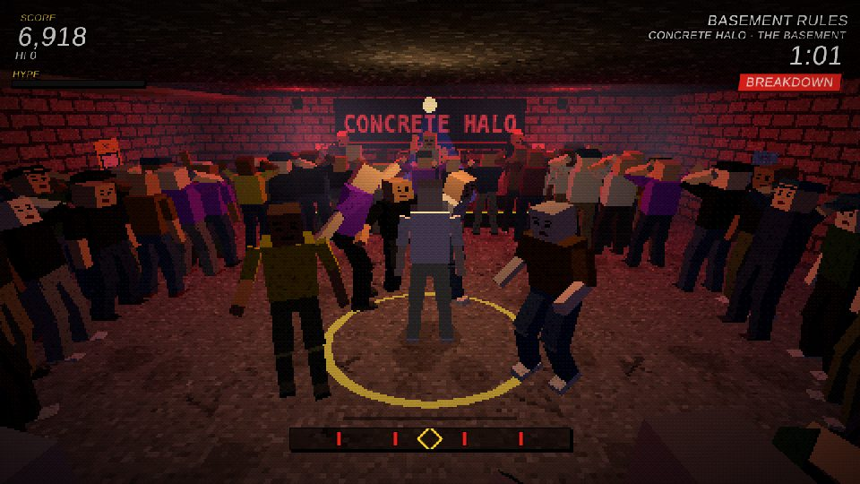

# MOSH PIT – Hardcore Arcade Simulator

> Tony Hawk's Pro Skater – nur eben im Hardcore-Moshpit.

Ein 3D-Arcade-Spiel im PS2-Retro-Look: Du bewegst dich frei durch den Pit eines verschwitzten Kellerclubs und
verkettest 2-Steps, Windmills, Spinkicks, Cartwheels und Butterfly Kicks zu langen Combos – mit Momentum, sauberen
Übergängen und Landungen wie in Tony Hawk's Pro Skater. Kein Rhythmusspiel: Die Musik gibt Boni, sie schreibt
nichts vor.



**Status:** Prototyp MOSH PIT 2.0 (Branch `claude/mosh-pit-2-prototype`) – spielbar im Browser. Plan: [docs/PROTOTYPE_2.md](docs/PROTOTYPE_2.md).

## Schnellstart

Voraussetzung: Node.js ≥ 22 (siehe `.nvmrc`).

```bash
npm install
```

```bash
npm run dev
```

Dann <http://localhost:5173> öffnen, eine Taste drücken (aktiviert Audio), **Arcade** → Song wählen.
Ins Bild klicken, um die Maus für die Kamera zu fangen.

| Befehl              | Zweck                                             |
| ------------------- | ------------------------------------------------- |
| `npm run dev`       | Dev-Server mit Hot Reload                          |
| `npm run build`     | Produktions-Build nach `dist/`                     |
| `npm run preview`   | Produktions-Build lokal ausliefern                 |
| `npm run typecheck` | TypeScript-Prüfung (strict)                        |
| `npm test`          | Unit- und Integrationstests (Vitest, headless)     |
| `npm run check`     | Typecheck + Tests + Build in einem                 |

## Steuerung

| Aktion                    | Tastatur / Maus        | Gamepad       |
| ------------------------- | ---------------------- | ------------- |
| Laufen                    | WASD                   | linker Stick  |
| Sprint / Anlauf           | Shift                  | RT / LT       |
| Footwork (2-Step)         | Q                      | X             |
| Arms (Windmill, auch im Laufen/2-Step) | E         | Y             |
| Kick: Spinkick / mit Anlauf Tornado Kick | R       | B             |
| Acro: Butterfly Kick / seitlich Cartwheel | Space  | A             |
| Kamera umsehen            | Maus (Klick = fangen)  | rechter Stick |
| Move-Liste ein/aus        | H                      | Back          |
| Pause                     | Esc / P                | Start         |

**Grundregeln:** Jeder Move bringt Punkte und +1 Multiplikator. Der Balken unter der Combo ist der Combo-Timer:
jeder Move füllt ihn auf, läuft er leer, wird die Combo kassiert (Punkte × Multiplikator × Abwechslung). Direkt
anschließen (CLEAN), mit Tempo in große Moves gehen (MOMENTUM), sauber landen, Arme über 2-Steps legen (LAYERED).
Wiederholungen bringen immer weniger. Breakdowns/Heavy Parts und Moves auf dem Beat geben Bonus. Wer einen Kick ins
Gedränge setzt, stürzt – die laufende Combo ist weg.

## Was ist drin (Prototyp 2.0)

- Eine Location (The Basement), ein detaillierter Spieler (Blender-Figur mit Motion Capture), Crowd und Band
- Momentum-Movement, Third-Person-Kamera, sechs Moves mit hybridem Eingabesystem, Ebenen und Cancel-Fenstern
- Combo-System mit Timer nach THPS-Vorbild ([docs/COMBO_SYSTEM.md](docs/COMBO_SYSTEM.md))
- Ein synthetisierter Testsong mit Breakdowns und Beatdrops (Platzhalter bis zur Originalmusik)
- Tastatur/Maus und Gamepad; Highscore und Einstellungen lokal gespeichert

Der Stand vor 2.0 (Phase 1, Rhythmus-/Groove-Mechanik, mehrere Songs und Modi) liegt als Referenz auf dem Branch
`claude/laughing-bell-msxkz3`.

## Projektstruktur

```
src/
  core/        Mathe, RNG, EventBus
  audio/       Song-Timeline, Song-Uhr, Synth-Player, SFX
  data/        Moves, Songs, Venues, Signature-Combos (reine Daten)
  gameplay/    Headless Spiellogik: Moves, Combo, Hype, Spieler, Crowd, Session
  animation/   Posen, Keyframe-Clips, Animator
  render/      Three.js: PS1-Pipeline, Rigs, Crowd-Instancing, Venue, Licht, Kamera
  input/       Tastatur/Maus/Gamepad → abstrakte Aktionen
  ui/          HUD, Menüs (DOM-Overlay)
  save/        LocalStorage-Spielstand
  game/        Game: Zustandsautomat und Frame-Loop
tests/         Vitest (läuft ohne Browser)
docs/          Design- und Technik-Dokumentation
```

## Dokumentation

| Dokument | Inhalt |
| --- | --- |
| [CLAUDE.md](CLAUDE.md) | Zentrale Arbeitsanweisungen für Claude-Code-Sessions |
| [docs/PROJECT_VISION.md](docs/PROJECT_VISION.md) | Vision, Zielgruppe, Abgrenzung |
| [docs/GAME_DESIGN.md](docs/GAME_DESIGN.md) | Gameplay-Systeme, Moves, Crowd, Progression, Modi |
| [docs/COMBO_SYSTEM.md](docs/COMBO_SYSTEM.md) | Move-Daten, Scoring-Formel, Timing |
| [docs/AUDIO_AND_MUSIC.md](docs/AUDIO_AND_MUSIC.md) | BPM-/Beat-System, Song-Format, neue Songs |
| [docs/TECHNICAL_ARCHITECTURE.md](docs/TECHNICAL_ARCHITECTURE.md) | Architektur, Game Loop, Systeme |
| [docs/ART_DIRECTION.md](docs/ART_DIRECTION.md) | PS1/PS2-Stil, Licht, Charaktere, UI |
| [docs/ASSET_PIPELINE.md](docs/ASSET_PIPELINE.md) | Assets, Formate, Lizenzen |
| [docs/ROADMAP.md](docs/ROADMAP.md) | Phasen, Stand, offene Aufgaben |
| [docs/DECISIONS.md](docs/DECISIONS.md) | Architektur- und Design-Entscheidungen |
| [docs/SESSION_HANDOFF.md](docs/SESSION_HANDOFF.md) | Übergabe zwischen Sessions |
| [CONTRIBUTING.md](CONTRIBUTING.md) | Workflow, Konventionen |
| [CHANGELOG.md](CHANGELOG.md) | Änderungen |

## Lizenz und Inhalte

Noch keine Lizenz festgelegt – bis dahin gilt: alle Rechte vorbehalten.
Alle Musikstücke, Sounds und Texturen werden zur Laufzeit prozedural erzeugt; es sind keine Fremd-Assets
enthalten. Songs, spielende Bands und Venues sind fiktiv. Auf Shirts und Flyern im Publikum stehen Namen echter
Hardcore-Bands als Text (keine Original-Logos); für eine kommerzielle Veröffentlichung wäre deren Erlaubnis nötig. Einzige Laufzeit-Abhängigkeit: [three.js](https://threejs.org) (MIT).
